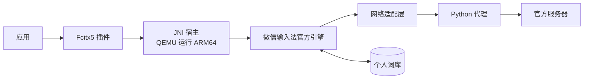

# 工作原理



- **Fcitx5 插件**：负责按键、候选窗、中英切换、标点和常用语候选。
- **JNI 宿主**：模拟 Android 环境，把官方引擎（`libwxhld.so`）跑起来。安卓版里 Java 层负责的事情（账号、网络、文件下载），由宿主和 Python 代理补上。
- **官方引擎**：生成候选，保存学习结果，执行同步和词库合并。日常在线同步和内部数据段合并由官方引擎处理；历史恢复可在关闭的副本用Python补齐原生漏掉的拼音记录，见[恢复历史词库](恢复历史词库.md)。
- **Python 代理**：替引擎联网。它复用关联时生成的设备身份，只放行已经核对过的请求。

## 代理放行的请求

| 请求 | 用途 | 处理 |
|---|---|---|
| 4329/2 | 云候选 | 联网 |
| 4814/34 | 设备组信息、常用语（不含剪贴板） | 联网，只读 |
| 4814/41、42 | 上传本机新学的词、拉取其他设备的变化 | 联网，检查账号、组号和单次条数 |
| 4814/44、60 | 查询快照、申请快照下载凭证 | 联网，只用于下载 |
| 4814/43 | 向设备组上报本机的全量状态 | 不联网，本地回复成功 |
| 4814/91 | 上屏内容报告 | 不联网，本地回复成功 |
| 其他 | 未核对的请求 | 拒绝 |

43 和 91 如果直接拒绝，引擎会不断重试；91 的待发队列（最多 100 条上屏内容）也会一直留在词库里。所以改为本地回复成功：引擎认为已经发送，就会清掉队列。

整库快照只下载、不上传。下载由代理用 HTTPS 完成，只接受腾讯云 COS 的地址，文件写进引擎的工作目录后，再通知引擎导入。

快照凭证的键来自成功的同组快照查询响应：包括 URL 文件名，以及设备编号与快照版本的组合。每次成功刷新都会替换这份集合，未知键和其他设备组的请求会被拒绝。

### 检查历史快照是否仍可下载

在源码目录运行：

```sh
python3 scripts/diagnose-snapshots.py
```

身份目录自定义时添加 `--state 身份目录`。工具只查询设备组、快照元数据和下载凭证，使用 HTTPS Range 请求读取每份文件的前32字节，不打开本地词库、不上传数据。报告仅包含匿名序号、元数据更新时间距今的天数、地址是否一致、HTTP状态及已知COS错误码；不包含设备编号、名称、词条、密钥或签名URL。

`snapshot_header_available` 表示文件头可读，完整文件下载、解密和候选验证仍由恢复流程完成。`metadata_object_not_found` 表示元数据列出的对象当前返回404 NoSuchKey；凭证申请成功并不保证对象存在。元数据URL的文件名与原生请求键不一致时，分别检查两种已知键。

官方全量状态请求43还可携带“需要其他成员重新提供快照”的控制信息。当前桥接对43本地回复成功，这类请求不会送达其他官方设备，因此打开官方客户端不能保证立即重建缺失快照；现有增量同步仍可继续。

### 下载可用快照与请求重建

```sh
python3 scripts/download-available-snapshot.py
```

工具优先选择关联时的来源设备，再检查其他同组、当前加密版本的快照。对象返回404 NoSuchKey时检查下一份；签名或其他HTTP错误会停止并报告。下载文件在私有身份目录的 `snapshot-recovery-*` 下，包含加密原件、解密文件和结构检查结果。工具检查头尾标记、数据段和拼音记录格式，不会将下载文件写进正式词库；候选与学习持久化仍需在隔离副本验证。

如果当前版本的备份均不可用，可先预览针对关联来源设备的重建请求：

```sh
python3 scripts/request-snapshot-refresh.py
```

确认来源后使用 `--send` 发送一次请求；来源变化时可用 `--peer 设备编号` 指定同组单个其他成员。这会让官方来源设备把它已有的个人词库备份到腾讯服务器，供关联组同步；Linux不上传整库。请求携带来源成员与请求时间，工具保存私有回执，一小时内不重复提交同一来源，不自动重试。来源设备需在线且实际触发官方同步；实际验证中，Mac输入后出现了更新的快照。服务器接受请求不等于来源设备已经完成备份。

快照更新后再次运行下载工具。验证完成或取消本次操作时，运行 `python3 scripts/request-snapshot-refresh.py --clear` 清除本次重建请求；已有本设备详情时恢复原详情，本设备尚无详情时保留不声明已上传备份的最小状态。清理不会删除来源设备的快照。上述工具均可用 `--state 身份目录` 指定现有关联身份。日常代理的43本地应答及整库上传拦截保持原策略。

## 云候选响应时限

云功能启用时，通过官方 `InitInfo.exptInfo` 配置将引擎的云响应有效期设为 1500ms。本地候选仍立即返回，云结果异步补入；输入已变化或已经选词的旧结果会被丢弃。关闭云功能时使用引擎默认值。

可在 `cloud.json` 中设置整数 `cloud_timeout_ms`，范围 200–5000。它控制引擎接收结果的有效期，网络请求本身仍受代理的 1.2 秒超时限制。配置在下次启动引擎时生效。

## 同步节奏

- 词库同步由引擎在你打字时触发：拉取最多约 10 分钟一次，上传大约 1 分钟一次。冲突由官方引擎处理。
- 每 5 分钟的定时任务只做三件事：续期登录、刷新设备组信息、更新常用语缓存。
- 设备组的开关和组号变化，要等输入法重启后才生效。

## 剪贴板同步

剪贴板由独立的用户进程运行，默认关闭，不通过输入引擎的网络代理。显式启用后，读取系统 CLIPBOARD 的纯文本变化，每 5 秒用 `4814/34` 的过滤位 `3` 查询设备组及最新剪贴板，用 `4814/36` 发送新复制的文本。设备组和来源必须有效，接收消息还须满足版本及服务器过期时间要求。

它复用关联身份和现有加密传输，只在读取身份时持有身份锁，五分钟刷新任务未运行时自己续期登录。没有直接用常驻 wxc：wxc 运行期间独占身份锁，而且其接收命令在写入系统剪贴板之前就推进了游标。系统剪贴板写入成功后才保存接收游标；接收文字不会回传。发送前保存不含文本的发送标识，遇到结果不明只核对远端，不自动重发。不发送文件。

图片同步需在启用时另加 `--images`，默认关闭。开启后，PNG/JPEG 图片用随机 16 字节密钥做 AES-128-CTR 加密，以 `4814/60`（`upload_biz` 6）请求 COS 上传凭证并上传密文，再用 `4814/36` 发布类型 6 消息，内容只有下载地址、原图 MD5 和密钥。接收时只从 `*.myqcloud.com` 下载，解密后核对 MD5 和格式，不符的消息记为已处理，不写入剪贴板。配置与操作说明见[剪贴板互通](剪贴板互通.md)。

## 语音输入

语音输入不经过引擎和代理。设置了语音键后，插件启动常驻的 `wetype-cloud.py voice --serve`，用标准输入输出的行协议控制它（格式见 `fcitx5-wetype/src/voice_input.h`）。按下语音键时发送 `START`，辅助进程这时才启动录音程序；松开发送 `STOP`，录音程序随即关闭。

- **编码**：16kHz 单声道 PCM 按 20ms 一帧，用系统 libopus 编码，参数与官方 `libvoiceopus.so` 一致（64kbps、复杂度 10、宽带），装进官方的 `#!OPUS_RAW_V1` 容器：16 字节文件头，之后每帧是 2 字节小端长度加 Opus 包。
- **请求**：`4547/0`，请求体直接是 `ImeVoiceTranslateReq{1: ImeVoiceRecognizeRequest}`，不套 4814 的业务信封。只填会话号、音频分包、编码类型 5、结束标志、包序号和累计字节数；官方客户端会附带的光标前后文字、最近发出的消息、应用名称和整理选项都不发送。
- **流式**：录音期间按响应里的 `interval`（约 100ms）攒包，包大小不超过响应里的 `max_packet_size`（约 3.5KB），序号从 1 递增。松开后发完剩余音频，再发一个空的结束包，然后以序号 0 轮询，直到响应的结束标志为真。每个响应里的文字都是到目前为止的完整结果。
- **连接**：复用一条 HTTPS 长连接，每个请求约省 40ms；每个请求持有身份锁，与云候选相同。录音、文字和响应都不落盘，错误只记录类别。

## 文件位置

| 内容 | 位置 |
|---|---|
| 设备身份 | `~/.local/state/wetype-ime/account`（可用 `$WETYPE_STATE_DIR` 修改） |
| 个人词库、常用语缓存 | `~/.local/share/wetype-ime` |
| 云功能配置 | `~/.config/wetype-ime/cloud.json` |
| 剪贴板开关、后端及图片开关 | `~/.config/wetype-ime/clipboard.json` |
| 剪贴板游标和运行统计（不含文本） | 身份目录下的 `clipboard-state.json`、`clipboard-status.json` |
| 引擎日志 | `~/.local/state/wetype-ime/harness.log`（可能包含输入内容） |
| 请求统计 | 身份目录下的 `native-sync-live/requests.jsonl`（只记录请求类型和大小，不记录内容） |
